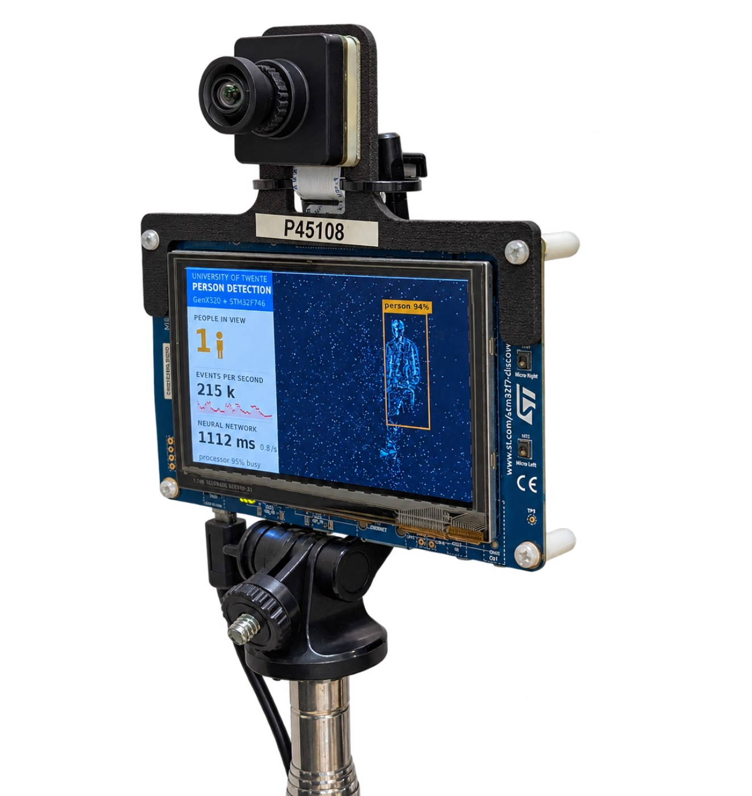

# Live person detection from an event camera on a Cortex-M7

Code, firmware and tools of the paper *"Live Person Detection from an Event Camera on a Cortex-M7: A Recorded
Dataset, In-Sensor Preprocessing, and Where the Cycles Go"* (A. Yousefzadeh et al., University of Twente, submitted
to IEEE MCSoC 2027), and of the **N-People** dataset recorded with it.

<p align="center">
  
  <br><em>The demonstrator: the board finds the person, counts the people in view and shows the event rate and the network time.</em>
</p>

A Prophesee **GenX320** event camera (320x320) on an **STM32F746G-DISCO** board (Cortex-M7 at 216 MHz, 320 KB SRAM,
8 MB SDRAM): the board decodes the events, builds a 50 ms event picture, runs a 0.28 M-parameter YOLO detector
(ST's YOLO-LC, fine-tuned on events, int8 body with a float head) and draws the boxes and the people count on its
own display. No PC in the loop.

- **Accuracy:** 0.70 AP50 on the public PEDRo benchmark at 160 px (0.75 at 192 px), measured with the int8 files
  that run on the board.
- **Speed:** 360 ms per network run at 160 px, about two updates per second with the event decoding and display.
- **Dataset:** N-People, 172 k labelled 50 ms pictures, 1.21 M person boxes, recorded with this setup by replaying
  annotated pedestrian videos (MOT17, PersonPath22) on a monitor in front of the sensor, plus room recordings:
  4TU.ResearchData, [doi:10.4121/e9e04333-cc28-4bfe-9079-7bb252203b02](https://doi.org/10.4121/e9e04333-cc28-4bfe-9079-7bb252203b02)
  (reserved; live once the record is published). Its description: [`docs/N-People.md`](docs/N-People.md).

## Repository

| folder | what |
|---|---|
| `firmware/` | the board's firmware: sensor set-up and event decoding (`App/events.c`), sensor-side filters and histogram mode (`App/sensor_filters.c`, `App/frames.c`), detector and counting (`App/detector.c`), float head (`App/head_float.c`), event-driven first layer (`App/sparse_conv1.c`), display, microSD recorder (`App/sdcard.c`); the network on TensorFlow Lite Micro + CMSIS-NN (`PersonDetection/`, models in `PersonDetection/models/`) |
| `tools/` | everything on the PC: the monitor bench, recording and labelling, curation, the event simulator, training, evaluation and the board measurements (below) |
| `docs/` | the dataset description, photos |

## The demo: build and flash

Needs `arm-none-eabi-gcc` (tested with 13.2) and `openocd` (0.12); the board on USB (ST-LINK, connector CN14).

```
cd firmware
make -j8            # build/person_detector.elf: the demo (160 px, int8 body + float head)
make flash          # write it with openocd
```

Other builds (all options are listed at the top of `firmware/Makefile`):

```
make MODEL=person_e1b_160_hf_int8                       # the detector trained with simulated events added
make MODEL=person_evt_v4_int8 NN_SIZE=192 HEAD_FLOAT=0  # the 192 px model of the monitor benches
make HISTO=1 MODEL=person_hist_v1_int8 NN_SIZE=192 HEAD_FLOAT=0   # sensor histogram mode (no event decoding)
make MODEL=st_yololcv1_192_int8 NN_SIZE=192 HEAD_FLOAT=0          # ST's COCO model as shipped
make SPARSE_L1=1 MODEL=person_evt_v4_int8 NN_SIZE=192 HEAD_FLOAT=0 # event-driven first convolution
make NN_BENCH=1 ...                                     # time the network at start-up (tools/nn_bench.py, bench_hf.py)
```

`tools/grab_lcd.py out.png` saves what the LCD shows, over SWD; `tools/board_sleep.sh sleep|wake` switches the board
(sensor, display) off and on without unplugging it.

## Python environment

The tools run from the repository root with a virtual environment in `work/venv` (Python 3.12) and keep their data
under `work/`:

```
python3 -m venv work/venv
work/venv/bin/pip install -r requirements.txt
```

`ultralytics` is only needed for the RGB-teacher curation, `pygame` only for the monitor bench.

## Using N-People

Download the tar files of the 4TU record and unpack them into `work/` (each holds `dataset_<pass>/<segment>/`):

```
for f in N-People/*.tar; do tar -xf "$f" -C work/; done
```

A segment holds the raw events (`events.raw`, Prophesee EVT2.0), the monitor log, the calibration and the labels;
the 50 ms pictures are made from the events by `tools/record_dataset.py label <segment>` (or
`tools/relabel_list.sh LIST`), which also writes the labels from the source annotations (`gt.txt` of the MOT17 and
PersonPath22 sequences under `work/datasets/`, see below). `splits.json` in the record names the test segments.

## Reproducing the paper

**Source videos.** MOT17 (`motchallenge.net`, CC BY-NC-SA 3.0) unpacked to `work/datasets/mot17/unzipped/MOT17/`;
PersonPath22 (`amazon-science/tracking-dataset`, CC BY-NC 4.0) to `work/datasets/personpath22/`
(`tools/pp22_prep.py` picks one 10 s window per video); PEDRo (Zenodo 13331985, CC BY 4.0) to
`work/datasets/pedro/raw/` (`tools/pedro_prep.py` converts it to the board's picture format).

**The monitor bench and recording** (Sec. IV of the paper)

| step | tools |
|---|---|
| monitor in front of the sensor, its own X display | `xserver.sh`, `monitor.py`, `show.sh`, `ddc.py` (brightness over DDC/CI) |
| where the monitor is in the sensor's picture | `calibrate.py`, `fov_map.py`, `recalibrate.sh` |
| 60 fps renderings (motion-compensated interpolation) | `make60.py`, `interp_flow.py` |
| zoomed crops, PersonPath22 windows | `zoom_plan.py`, `pp22_prep.py` |
| record a pass to the board's microSD, copy it, label it | `dataset_run.py`, `record_dataset.py`, `sdrec.py`, `evt2.py`, `histo_raw.py` |
| unattended campaign (passes, calibrations, copies, room light from a webcam) | `campaign.py`, `room_light.py`, `grab_cam.py` |
| room recordings with a person, labels from the motion, multi-person composites | `self_record.py`, `real_label.py`, `real_composite.py` |
| close-up crops of the full-view passes | `zoom_dataset.py` |

**Curation** (Sec. IV-B): `curate.py align` (label offset, time shift and event contrast of every segment),
`rgb_teacher.py` (YOLO11x on the source frames; unlabelled people become regions to ignore through
`teacher_to_gt.py`), `relabel_list.sh`.

**Simulated events** (Sec. IV-D): `evsim.py` (ESIM-style simulator with the sensor's rate cap and noise, fitted on the
recordings), `paper_figs.py pair` shows a real and a simulated picture of the same moment.

**Training and evaluation** (Sec. III-C, V-A): `finetune.py` (YOLOv2 loss with ignore regions; `--val` selects the
segments for early stopping, `--exclude` keeps segments out of both), `train_lists.py` (the data mixes of the paper's
table), `resize_model.py` (128/160/192/224 px), `headfloat.py` (int8 body + float head, writes the firmware header),
`split_model.py` and `build_hf.sh` (firmware with a new model), `quantize.py`, `eval_ap.py` and `eval_suite.py`
(AP50, AP50:95, bootstrap over segments, all test sets), `eval_run.sh`, `yolo_ref.py` and `evpic.py` (the board's
input on the PC).

**Board measurements** (Sec. V-B to V-D): `nn_bench.py`, `bench_hf.py` and `board_session.sh` (network time,
board output against the PC), `replay_check.py` (counts of replayed recordings), `room_sim.py` (counting bench with
two and three people), `profile_log.py` (where the cycles go), `sparse_conv1.py` (the event-driven first layer's
constants, bit-exact check), `act_sparsity.py` (activation sparsity), `bench_mot.py` and `det_log.py` (live
precision/recall on the monitor), `peek.py`.

**Paper numbers and figures:** `dataset_stats.py`, `paper_figs.py`, `package_dataset.py` (the 4TU record).

## Licences

Our code and firmware: Apache License 2.0 (`LICENSE`). Third-party parts (Prophesee's GenX320 driver, ST's HAL and
CubeMX code, FreeRTOS, FatFs, TensorFlow Lite Micro, ST's YOLO-LC model and the networks fine-tuned from it, a font,
one COCO photo) keep their own licences, listed in `NOTICE`. N-People: CC BY-NC-SA 4.0 (it derives from MOT17 and
PersonPath22; do not use it to identify people).

## Citation

See `CITATION.cff`. Dataset: A. Yousefzadeh, *N-People: person detection with a GenX320 event camera, recorded from a
monitor and in a room*, 4TU.ResearchData, 2026, doi:10.4121/e9e04333-cc28-4bfe-9079-7bb252203b02. The paper's
reference follows on acceptance.
