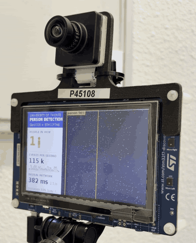

# Live person detection from an event camera on a Cortex-M7

Code, firmware and tools of the paper *"Live Person Detection from an Event Camera on a Cortex-M7: A Recorded
Dataset, In-Sensor Preprocessing, and Where the Cycles Go"*, and of the **N-People** dataset recorded with it.

<p align="center">
  
  <br><em>The board running live. It finds the people,
  counts them and shows the event rate and the network time on its own display.</em>
</p>

A Prophesee **GenX320** event camera (320x320) on an **STM32F746G-DISCO** board (Cortex-M7 at 216 MHz, 320 KB SRAM,
8 MB SDRAM): the board decodes the events, builds a 50 ms event picture, runs a 0.28 M-parameter YOLO detector
(ST's YOLO-LC, fine-tuned on events, int8 body with a float head) and draws the boxes and the people count on its
own display. No PC in the loop.

- **Accuracy** (160 px, int8 body + float head; PC evaluation of the int8 files, stopping epochs chosen on training
  data only): the demo's network, trained on all of N-People, reaches 0.33-0.40 AP50 on held-out MOT17 replays and
  0.18 on PersonPath22 replays (the 54 test videos with reliable timing). The same architecture fine-tuned on the public PEDRo benchmark reaches 0.70 AP50 there at 160 px and 0.75 at
  192 px. All of these networks are in `models/paper/`.
- **Speed:** 362 ms per network run at 160 px on a stored picture; live in an office 378 ms (median; 410 ms at the
  90th percentile) with the event decoding running, an update every 0.44 s (2.3 per second).
- **Dataset:** N-People, 172 k labelled 50 ms pictures, 1.21 M person boxes, recorded with this setup by replaying
  annotated pedestrian videos (MOT17, PersonPath22) on a monitor in front of the sensor, plus room recordings:
  4TU.ResearchData, [doi:10.4121/e9e04333-cc28-4bfe-9079-7bb252203b02](https://doi.org/10.4121/e9e04333-cc28-4bfe-9079-7bb252203b02).
  Its description: [`docs/N-People.md`](docs/N-People.md).

## Repository

| folder | what |
|---|---|
| `firmware/` | the board's firmware: sensor set-up and event decoding (`App/events.c`), sensor-side filters and histogram mode (`App/sensor_filters.c`, `App/frames.c`), detector and counting (`App/detector.c`), float head (`App/head_float.c`), event-driven first layer (`App/sparse_conv1.c`), display, microSD recorder (`App/sdcard.c`); the network on TensorFlow Lite Micro + CMSIS-NN (`PersonDetection/`, models in `PersonDetection/models/`) |
| `tools/` | everything on the PC: the monitor bench, recording and labelling, curation, the event simulator, training, evaluation and the board measurements (below) |
| `models/paper/` | the networks behind the paper's accuracy tables (int8, and int8 body + float head) |
| `docs/` | the dataset description, the photo and the video |

The firmware also contains an experimental counting head (`App/count_head.c`, `tools/count_*.py`; off by default,
`make COUNT_HEAD=1`) that the paper does not use.

## The demo: build and flash

Needs `arm-none-eabi-gcc` (tested with 13.2) and `openocd` (0.12); the board on USB (ST-LINK, connector CN14).

```
cd firmware
make -j8            # build/person_detector.elf: the demo (160 px, int8 body + float head)
make flash          # write it with openocd
```

Other builds (all options are listed at the top of `firmware/Makefile`):

```
make MODEL=person_e1b_160_hf_int8                       # the detector trained with simulated events added
make MODEL=person_evt_v4_int8 NN_SIZE=192 HEAD_FLOAT=0  # the 192 px model of the monitor benches
make HISTO=1 MODEL=person_hist_v1_int8 NN_SIZE=192 HEAD_FLOAT=0   # sensor histogram mode (no event decoding);
                                                        # flash it with the same options + flash
make MODEL=st_yololcv1_192_int8 NN_SIZE=192 HEAD_FLOAT=0          # ST's COCO model as shipped
make SPARSE_L1=1 MODEL=person_evt_v4_int8 NN_SIZE=192 HEAD_FLOAT=0 # event-driven first convolution (192 px, int8 only)
make NN_BENCH=1 ...                                     # time the network at start-up (tools/nn_bench.py, bench_hf.py)
```

`tools/grab_lcd.py out.png` saves what the LCD shows, over SWD (it halts the processor for a moment, so the display
freezes briefly); `tools/board_sleep.sh sleep|wake` switches the board (sensor, display) off and on without
unplugging it. The tools that read the board's serial port use `/dev/ttyACM0` (set `GENX_SERIAL` otherwise).

**Recording without a PC.** The bottom row of the panel is a record button: touch it, or press the blue USER button,
to start recording the raw events to the microSD card, and again to stop (the detector keeps running). Each
recording is `evt/recNNNN.raw` on the card (Prophesee EVT2.0 with a text header that states the sensor
configuration) plus `recNNNN.txt` (board ticks, counters); the file is synced every 5 s, so a recording survives the
power going off. On a USB power bank (ST-LINK port) the board records anywhere. Copy the files with a card reader,
or over the debug link with `tools/sdrec.py read NO OUT.raw` (slow).

## Python environment

The tools run from the repository root with a virtual environment in `work/venv` (Python 3.12) and keep their data
under `work/`:

```
python3 -m venv work/venv
work/venv/bin/pip install -r requirements.txt
```

`ultralytics` is only needed for the RGB-teacher curation, `pygame` only for the monitor bench.

## Using N-People

Download `N-People-v1.0.zip` from the 4TU record, unzip it anywhere and link its pass folders
(`N-People/<MOT17|PersonPath22|Room>/dataset_<pass>/`) into `work/`:

```
unzip N-People-v1.0.zip -d /path/to/data
for d in /path/to/data/N-People/*/dataset_*; do ln -s "$d" work/; done
```

A segment holds the raw events (`events.raw`, Prophesee EVT2.0), the monitor log, the calibration and the labels;
`N-People/splits.json` names the test and training segments. The 50 ms pictures are not in the record:
`tools/record_dataset.py label <segment>` (or `tools/relabel_list.sh LIST`, a file with one segment per line) makes
them from the events and writes the labels again from the source annotations, so it needs the source sequences
(next section). The room recordings (`dataset_real1`) are labelled from the motion (`tools/real_label.py label`);
`tools/room_split.py` then makes `work/dataset_room_train`, the room part of the training and test data.

## Reproducing the paper

**Source videos and models.**
- MOT17 (`motchallenge.net`, CC BY-NC-SA 3.0) unpacked to `work/datasets/mot17/unzipped/MOT17/`, and its 60 fps
  renderings: `tools/make60.py work/datasets/mot17_60/train work/datasets/mot17/unzipped/MOT17/train/MOT17-*-FRCNN`.
- PersonPath22 (`amazon-science/tracking-dataset`, CC BY-NC 4.0) to `work/datasets/personpath22/`;
  `tools/pp22_prep.py` cuts one 10 s window per video (`work/datasets/pp22/`) and renders it at 60 fps
  (`work/datasets/pp22_60/`).
- PEDRo (Zenodo 13331985, CC BY 4.0) to `work/datasets/pedro/raw/`; `tools/pedro_prep.py` converts it to the board's
  picture format.
- ST's YOLO-LC v1 (`st_yololcv1_192`, STM32 model zoo on GitHub, object detection) as Keras model to
  `work/models_zoo/st_yololcv1_192.keras`: the starting point of every fine-tuning run.

The labeller finds a segment's source sequence under `work/datasets/` wherever the recording was made.

**The monitor bench and recording** (Sec. IV of the paper)

| step | tools |
|---|---|
| monitor in front of the sensor, its own X display | `xserver.sh`, `monitor.py`, `show.sh`, `ddc.py` (brightness over DDC/CI) |
| where the monitor is in the sensor's picture | `calibrate.py`, `fov_map.py`, `recalibrate.sh` |
| 60 fps renderings (motion-compensated interpolation) | `make60.py`, `interp_flow.py` |
| zoomed crops, PersonPath22 windows | `zoom_plan.py`, `pp22_prep.py` |
| record a pass to the board's microSD, copy it, label it | `dataset_run.py`, `record_dataset.py`, `sdrec.py`, `evt2.py`, `histo_raw.py` |
| unattended campaign (passes, calibrations, copies, room light from a webcam) | `campaign.py`, `room_light.py`, `grab_cam.py` |
| room recordings with a person, labels from the motion, multi-person composites | `self_record.py`, `real_label.py`, `real_composite.py` |
| close-up crops of the full-view passes (`work/dataset_zoom`) | `zoom_dataset.py` |
| the room split (`work/dataset_room_train`) | `room_split.py` |

**Curation** (Sec. IV-B): `curate.py align` (label offset, time shift and event contrast of every segment),
`rgb_teacher.py` (YOLO11x on the source frames; unlabelled people become regions to ignore through
`teacher_to_gt.py`), `relabel_list.sh`.

**Simulated events** (Sec. IV-D): `evsim.py` (ESIM-style simulator with the sensor's rate cap and noise; its
parameter ranges were chosen with the statistics of `evsim_calib.py` on the recordings of MOT17-02 at 60 fps),
`train_lists.py synth N` (a random subset for training, `work/synth_mix`), `paper_figs.py pair` (a real and a
simulated picture of the same moment).

**Training and evaluation** (Sec. III-C, V-A): `finetune.py` (YOLOv2 loss with ignore regions; `--val` selects the
segments for early stopping, `--exclude` keeps segments out of both), `train_lists.py` (the data mixes of the paper's
table), `resize_model.py` (128/160/192/224 px), `headfloat.py` (int8 body + float head, writes the firmware header),
`split_model.py` and `build_hf.sh` (firmware with a new model), `quantize.py`, `eval_ap.py` and `eval_suite.py`
(AP50, AP50:95, bootstrap over segments, all test sets), `eval_run.sh`, `yolo_ref.py` and `evpic.py` (the board's
input on the PC).

**Board measurements** (Sec. V-B, V-C): `nn_bench.py`, `bench_hf.py` and `board_session.sh` (network time,
board output against the PC), `replay_check.py` (counts of replayed recordings), `room_sim.py` (a counting bench with
two and three people overlaid from the room recordings; not in the paper), `profile_log.py` (where the cycles go), `sparse_conv1.py` (the event-driven first layer's
constants, bit-exact check), `act_sparsity.py` (activation sparsity), `bench_mot.py` and `det_log.py` (live
precision/recall on the monitor), `peek.py`, `power_estimate.py` (indicative power from the STM32F746 datasheet).

Many tools assume this lab's bench: a monitor on X display `:1` (`xserver.sh`), its DDC/CI bus (`DDC_BUS`), a webcam
for the room light, and the board on `/dev/ttyACM0`.

**Paper numbers and figures:** `dataset_stats.py`, `paper_figs.py`, `package_dataset.py` (the 4TU record).

## Licences

Our code (firmware application, network glue, tools): Apache License 2.0 (`LICENSE`). Third-party parts keep their
own licences, listed in `NOTICE`: Prophesee's GenX320 driver (Apache 2.0), ST's HAL and board support (BSD-3-Clause),
CMSIS and TensorFlow Lite Micro (Apache 2.0), FreeRTOS (MIT), FatFs, a font, two self-test event pictures from N-People. **Not open source:** the
STM32CubeMX-generated files in `firmware/Core/` and every network (ST's YOLO-LC and the networks fine-tuned from it)
are under ST's SLA0044, which allows their use only on STMicroelectronics devices. N-People: CC BY-NC-SA 4.0 (it
derives from MOT17 and PersonPath22; do not use it to identify people).

## Citation

See `CITATION.cff`. Dataset: A. Yousefzadeh, *N-People: person detection with a GenX320 event camera, recorded from a
monitor and in a room*, 4TU.ResearchData, 2026, doi:10.4121/e9e04333-cc28-4bfe-9079-7bb252203b02. The paper's
reference follows on publication.
